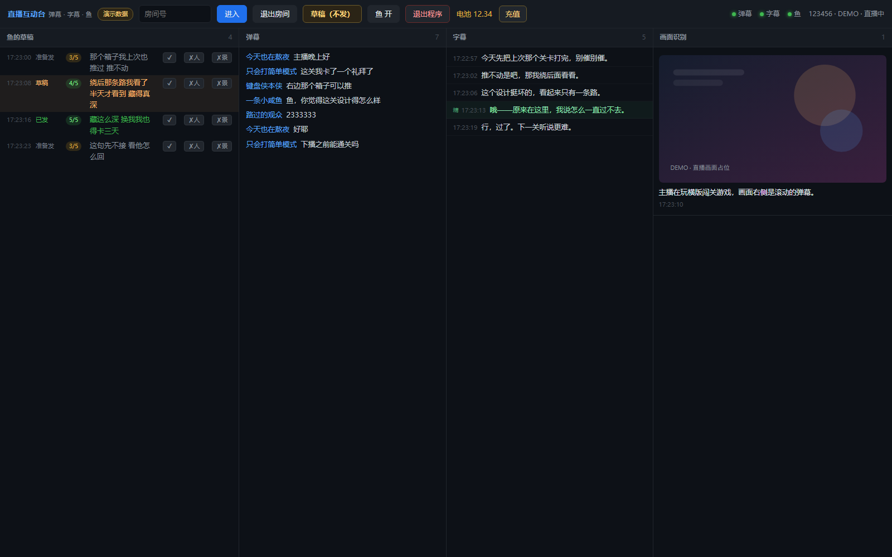

# live-deck

> A local copilot for Bilibili live rooms: danmaku, subtitles, frame understanding, and a virtual
> viewer that knows when to **stay quiet**.

[](LICENSE)
[](pyproject.toml)



*Screenshot from `live-deck demo`: no Bilibili account, no model calls — all four streams are scripted.*

## What it is

A single-window desktop app (WebView2 or browser) that runs entirely on your machine:

- **Danmaku** — live chat over Bilibili's WebSocket.
- **Subtitles** — local ASR (SenseVoice), optional Demucs vocal separation. Two passes:
  a fast int8 pass (~8 s latency) and a slow fp32 "polish" pass that re-reads the last 36 s.
- **Scene** — one frame every 60 s, described by a multimodal model in one sentence.
- **The fish** — a persona that reads subtitles + danmaku + scene and decides whether to reply.
  Every candidate reply is scored 1–5 for "does this sound human in *this* moment";
  below the `veto` threshold it is dropped. Silence (`SKIP`) is a first-class outcome.

It is not a spam bot. The default posture is read-only: no danmaku, no gifts, no spending.
Both sending abilities are behind explicit config gates, and gifts additionally require a daily budget.

## Quick start

```bash
git clone https://github.com/Ta0Sheng/live-deck.git
cd live-deck

python -m venv .venv
source .venv/bin/activate        # Windows: .venv\Scripts\activate
pip install -e ".[asr]"
live-deck init
live-deck demo                   # see the UI in ~30 seconds, no account needed
```

Real use:

```bash
live-deck login                  # scan a QR code with the Bilibili app
live-deck models install         # ~300 MB of local ASR models
live-deck doctor                 # check what is missing and how to fix it
live-deck app
```

GPU subtitles: `pip install -e ".[asr-gpu]"` (CUDA-enabled torch). Without a GPU, CPU works at ~1.8×
realtime for the separation stage.

## Design notes

- **Persona and memory are separate.** `persona/` is versioned; `data/` and `fish.memory` are
  gitignored. A fresh clone has the character but no history.
- **Two learning axes.** "Sounds human" and "should speak at all" are separate sample files, so
  training one does not corrupt the other.
- **Hard safety gates.** `fish.send_danmaku` and `fish.allow_gift` default to `false`; a CLI flag
  cannot override them. Gifts go through a per-day ledger.
- **Process hygiene.** Single-instance checks, orphan cleanup, exponential backoff when the stream
  is offline, and killing the whole process tree when the window closes.
- **Graceful degradation.** No pywebview → browser. No ASR extras → danmaku-only monitor.
  Missing model → clear error with the command to fix it.

## Documentation

Chinese docs are the primary ones:

- [Architecture and trade-offs](docs/architecture.md)
- [Deployment](docs/deployment.md)
- [Persona guide](docs/persona.md)
- [FAQ](docs/faq.md)
- [Security and privacy](SECURITY.md)

## License

GPL-3.0-or-later. `bilibili-api-python` is GPL-3.0, and this project imports it directly.

Bilibili is a trademark of its owner. This project is not affiliated with Bilibili.
Automating a live room may violate the platform's terms of service; use at your own risk.
