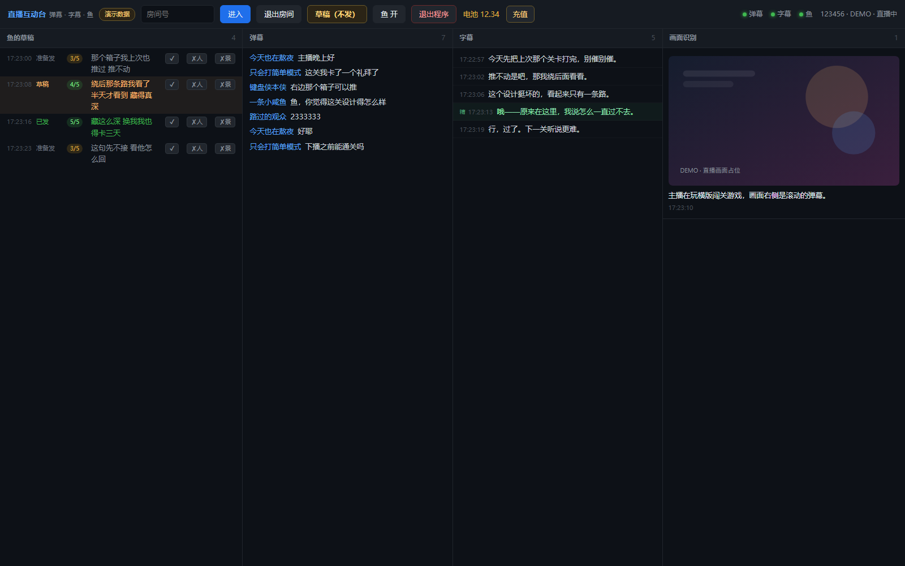
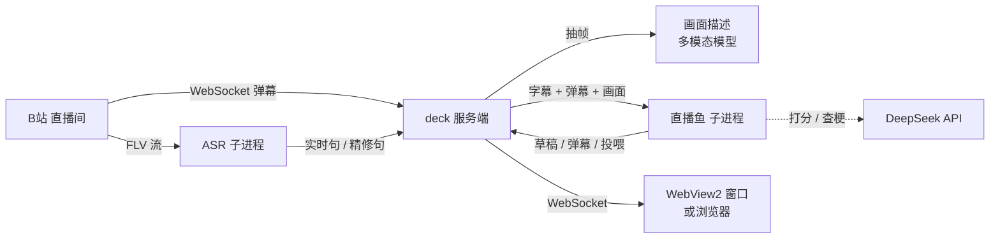

# live-deck · 直播互动台

> 一个只在本地跑的 B站 直播间「副驾驶」：把弹幕、语音、画面拆成三条实时数据流，
> 再放一个**会看场面、也会闭嘴**的观众进去。

[](LICENSE)
[](pyproject.toml)
[](https://github.com/YOUR_NAME/live-deck/actions/workflows/ci.yml)

<!-- 发布前把上面两处 YOUR_NAME 换成你的 GitHub 用户名 -->



*`live-deck demo` 的截图：不连 B站、不调模型，四条流都是脚本喂的，所以没有任何真实观众数据。*

---

## 它是什么

一个跑在你电脑上的单窗口程序。左边是直播鱼（一个虚拟观众）的发言草稿，中间是弹幕和本地字幕，
右边是画面理解。字幕和画面理解全部本地推理；只有「这句话要不要说、怎么说」才调用一次 LLM。

它和「弹幕机器人」的区别只有一点：**它默认不说话**。十个场面里能接一两个就算活跃，
其余时候安静看着。每条发言在发出去之前，会先被自己的另一路判断打一个「像人度」分，
低于阈值就自我否决。

- **弹幕流** —— 实时接收，可选中复制
- **字幕流** —— 本地 ASR（SenseVoice），可选 Demucs 人声分离；双路：实时 + 精修
- **画面理解** —— 定时抽一帧，用多模态模型写一句「主播现在在干嘛」
- **直播鱼** —— 读字幕 + 弹幕 + 画面，决定接不接、接什么；有知识库、会查梗、会沉默
- **反馈闭环** —— 界面上 ✔ / ✘人 / ✘景 三个按钮，把你的判断变成下一次的样本

## 为什么值得读这份代码

| 设计 | 为什么这么做 |
|---|---|
| **双路字幕** | 实时通道（int8、4 秒切片）保证 8 秒内出字；精修通道（fp32、回看 36 秒）每 30 秒补一版更准的句子。慢的那路只写给鱼看，不挡界面 |
| **像人度自评** | 生成完先让另一个 prompt 就「这一刻的语境」打 1–5 分，低于 `veto` 直接丢弃。把「像不像人」从玄学变成可调的阈值 |
| **两条学习轴** | 「话说得像不像人」和「这个场面该不该开口」分开记样本。负例分两轴、正例合一，避免两条线互相污染 |
| **检索式样本 + 离线评测** | 旧经验不再被「最近 24 条」挤掉：按当前场面相似度取样本；固定评测集让每次改动都能用数字比较 |
| **人格 / 记忆 / 配置三层分离** | 人格进仓库、跟着项目走；记忆和样本落在 `data/`（gitignore），新电脑上是空的。换人格不动代码，清记忆不丢人格 |
| **安全默认** | `send_danmaku` / `allow_gift` 两道硬闸默认关；送礼还有按天预算账本。任何命令行参数都绕不过配置 |
| **进程治理** | 单实例文件锁、孤儿进程清理、下播退避、关窗杀整棵进程树。这些是「跑一整晚不出事」和 demo 的差别 |
| **无账号可跑** | `live-deck demo` 用脚本喂四条流，clone 下来 30 秒就能看到完整界面 |

## 架构



三条流各跑各的，互不阻塞：

1. **弹幕**：服务端持有 B站 WebSocket，收到就广播给界面，并顺手记进 `data/danmaku/`（学这间房的说话习惯）。
2. **字幕**：独立子进程拉流 → （可选）Demucs 分出人声 → 能量切句 → SenseVoice；精修句回看更长音频。
3. **画面**：每 60 秒抽一帧 → 多模态模型一句话描述 → 作为「现在的场面」喂给鱼。
4. **鱼**：另一条子进程。它读字幕日志最后几行 + 弹幕缓冲，决定 `SKIP` 还是说一句；说之前先自评。

服务端只做编排和转发，不碰模型推理；子进程挂了会被拉起，直播结束会自己下班。

更细的时序、失败处理和取舍见 [docs/architecture.md](docs/architecture.md)。

## 快速开始

要求：Python **3.11+**、`ffmpeg` 在 PATH 里。字幕需要额外装 `.[asr]`；有 NVIDIA 显卡可以装 `.[asr-gpu]`。

```bash
git clone https://github.com/YOUR_NAME/live-deck.git
cd live-deck

python -m venv .venv
# Windows: .venv\Scripts\activate
# macOS/Linux: source .venv/bin/activate

pip install -e ".[asr]"        # CPU 字幕；GPU 用 ".[asr-gpu]"
live-deck init                 # 生成 config.toml + data/
live-deck demo                 # 不登录、不下模型，先看界面
```

演示模式会直接开浏览器（或窗口），30 秒后四条流就都有内容了。

### 正式使用

```bash
pip install -e ".[asr]"          # CPU 字幕；GPU 用 ".[asr-gpu]"
pip install -e ".[window]"       # 可选：原生窗口；装不上会自动用浏览器
live-deck login                  # 手机 B站 扫码，凭证写进 .secrets/
live-deck models install         # 下 SenseVoice（约 230 MB）+ 流式模型（74 MB）
live-deck doctor                 # 体检：缺什么、怎么修
live-deck app                    # 启动
```

也可以完全不用桌面窗口：

```bash
live-deck serve --room 123456 --open
```

> **Python 3.13/3.14 的 pywebview**：它依赖的 pythonnet 可能还没跟上。装不上、或者装上了但后端起不来，
> `live-deck app` 都会自动退回浏览器，功能一样。

### 三句话版本

```bash
pip install -e ".[asr]" && live-deck init && live-deck demo
```

## 配置

`config.toml` 由 `live-deck init` 从 [config.example.toml](config.example.toml) 生成，**不进 git**。
所有相对路径都相对这个文件所在目录，整个文件夹搬走不用改。

| 键 | 默认 | 说明 |
|---|---|---|
| `deck.port` | `8765` | 界面端口 |
| `deck.python` | `""` | 窗口宿主与服务端分 venv 时，填服务端解释器 |
| `deck.asr_engine` | `sensevoice` | `sensevoice`（准，~8s）或 `streaming`（快，错字多） |
| `asr.model_dir` | `models/sensevoice` | 模型目录，`live-deck models install` 会填 |
| `asr.clean` | `true` | 开精修通道（fp32 + 36s 上下文） |
| `fish.persona` | `persona/persona.md` | 人格文件 |
| `fish.memory` | `""` | 长期记忆文件；留空 = 不带记忆 |
| `fish.min_gap` | `75` | 两条发言基准间隔（秒），实际会随机化 |
| `fish.veto` | `3.3` | 像人度低于此分不发；调高更安静 |
| `fish.send_danmaku` | `false` | **总闸**：关着就永远只出草稿 |
| `fish.allow_gift` | `false` | **总闸**：关着就永远不会花钱 |
| `fish.gift_daily_budget` | `0` | 允许送礼时每天最多花多少金瓜子（100 = 1 元） |
| `fish.owner_uid` | `""` | 只有这个 uid 能点单送礼；空 = 谁都不行 |
| `fish.retrieval` | `true` | 按场面检索样本；`false` 退回「最近 N 条」 |
| `fish.good_k` / `bad_k` | `8` / `4` | 每次注入的相似样本数 |

## 人格与记忆

这是这个项目最想讲清楚的一件事：**人格是代码资产，记忆是用户数据。**

```
persona/                  ← 进仓库，随项目走
├── persona.md            system prompt：它是谁、怎么说话
├── examples/             正/负/语境样本（可被 data/ 覆盖）
├── knowledge/            空目录说明
└── corpus/               可选：语感参考语料（不放受版权保护的内容）

data/                     ← gitignore，新电脑上是空的
├── samples/              界面 ✔/✘ 写这里（首次从 examples/ 播种）
├── knowledge/            它问明白过的词/梗
├── danmaku/              这间房的弹幕习惯
├── logs/                 字幕、打分、鱼日志
└── state/                模式、上次房间、礼物账本
```

换一个人格：改 `persona/persona.md`（或把 `fish.persona` 指向你自己的文件），不用动代码。
清空记忆：删 `data/`，人格和示例还在。
`live-deck persona` 可以快速看当前人格文件。

学习闭环的三个按钮：

- **✔** —— 语境合适 + 说得像人 → 同时进「好弹幕」和「语境自然」
- **✘人** —— 说话方式不像人 → 进「别这么说」
- **✘景** —— 这个场面不该开口 → 进「语境不对」

负例分两轴，是为了让「什么时候闭嘴」不被「怎么说话」的样本带偏。

样本也不是「只取最近 N 条」：每次发言前按当前场面从 `data/samples/` 里检索最像的
8 条好样本 / 4 条坏样本，再带上最近 4 条兜底——旧经验不会被新样本挤掉，你刚点的反馈也立刻生效
（`fish.retrieval`，可关掉退回旧行为做 A/B）。

### 评测：它到底有没有变好

```bash
live-deck eval make --n 40      # 从 data/logs 抽 40 个固定场面（也可 --logs 指旧项目日志）
live-deck eval run              # 逐条生成候选，盲评 1–5（--auto 用评审器自动打分）
live-deck eval report           # 最近几次的均分 / 跳过率 / 平均长度并排
```

场面固定、尺子固定，改动（检索、样本、人格、模型）才有可比性。`eval run` 的结果写在
`data/eval/runs/`，和评测集一样不进 git——它们是「这条鱼经历过什么」，不是代码。

## 安全与合规

- 默认**只读**：不发弹幕、不送礼。要真发必须改配置，且送礼还要过每日预算。
- 凭证只存在 `.secrets/`，已 gitignore；凭证文件等于账号密码，别外发。
- 本项目只调用公开 Web 端接口，不包含绕过风控、验证码或实名的实现。
- 未实名账号的弹幕会被 B站 **静默丢弃**（接口返回成功但别人看不到）。这是平台行为，不是 bug。
- 送礼会真实扣费。默认「投喂」只是一条文本弹幕，不调支付接口。

> 本项目与哔哩哔哩无任何关联，仅供学习与研究。自动化操作可能违反平台用户协议；
> 账号限制、财产损失等后果由使用者自行承担。详见 [SECURITY.md](SECURITY.md)。

## 实测

在这台开发机（Windows 11 / RTX 3050 8GB / Python 3.14 服务端 + 3.12 窗口宿主）上：

| 项目 | 实测 |
|---|---|
| Demucs `htdemucs` 人声分离 | 7.4× 实时（GPU，4 秒切片），约 2.9 GB 显存 |
| 同模型 CPU | 1.8× 实时 |
| 字幕延迟（v2 实时通道） | ≈ 8 秒 |
| 字幕延迟（精修通道） | ≈ 30 秒，只写给鱼，不挡界面 |
| 单条发言的模型调用 | 2 次短请求（生成 + 打分），按 DeepSeek 现价约 0.01 元量级 |
| 长时间运行 | 下播后退避封顶 60 秒；单实例锁防止叠进程 |

## 项目结构

```
live-deck/
├── src/live_deck/
│   ├── deck/          aiohttp + WebSocket 服务端、单文件界面
│   ├── fish/          直播鱼：人格加载、决策循环、预算
│   ├── asr/           streaming（快）/ sensevoice（准）
│   ├── demo.py        演示模式的数据源
│   ├── cli.py         init / doctor / login / models / serve / app / demo / eval
│   ├── config.py      TOML + 环境变量 + 相对路径
│   ├── bili.py        凭证、房间、流地址、抽帧、钱包
│   └── host.py        桌面窗口（pywebview / 浏览器降级）
├── persona/           人格与示例（进仓库）
├── tests/             50 个离线测试，不需要账号
├── docs/              架构、部署、人格、FAQ
├── scripts/           Windows / Unix 一键脚本
└── .github/workflows/ CI：ruff + pytest（Ubuntu/Windows × 3.11–3.13）
```

## 已知限制

- 只支持 B站；其他平台需要自己实现 `bili.py` 的对应部分。
- 强 BGM、游戏音效、多人抢话时，字幕仍会错；人声分离能缓解但不能消除。
- Windows 是主战场（WebView2、窗口宿主）；macOS/Linux 走浏览器降级。
- 一次只跟一个直播间。
- 鱼的判断依赖 LLM，不同模型/温度下表现会有波动；这是特性也是限制。

## 文档

- [架构与取舍](docs/architecture.md)
- [部署（Windows / Linux / GPU）](docs/deployment.md)
- [人格写法与调参](docs/persona.md)
- [常见问题](docs/faq.md)
- [安全与隐私](SECURITY.md)
- [参与开发](CONTRIBUTING.md)

## License

**GPL-3.0-or-later**。核心依赖 [`bilibili-api-python`](https://github.com/Nemo2011/bilibili-api) 是 GPL-3.0，
本项目直接 import 它，因此整体以 GPL-3.0 发布。

其他依赖：sherpa-onnx（Apache-2.0）、SenseVoice / FunAudioLLM（见其模型许可）、
Demucs（MIT）、PyAV（BSD-3）、PyWebView（BSD-3）。

## 致谢

- [k2-fsa/sherpa-onnx](https://github.com/k2-fsa/sherpa-onnx) 与 [SenseVoice](https://github.com/FunAudioLLM/SenseVoice)：本地识别
- [facebookresearch/demucs](https://github.com/facebookresearch/demucs)：人声分离
- [Nemo2011/bilibili-api](https://github.com/Nemo2011/bilibili-api)：弹幕、房间、凭证
- [DeepSeek](https://www.deepseek.com/)：发言与打分
